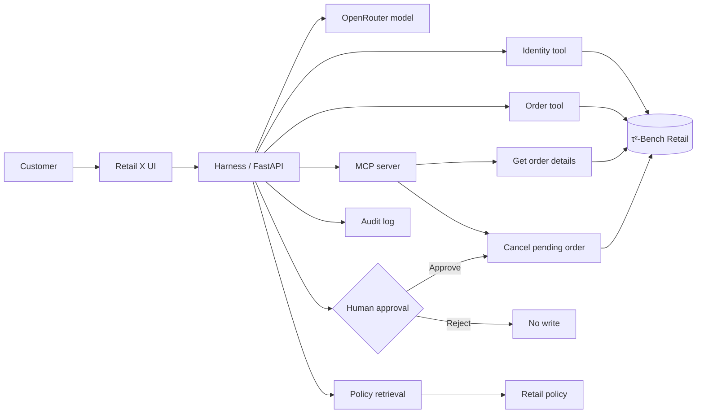

<p align="center">
  
</p>


<p align="center">
</p>
<p align="center">
  
</p>

# Retail X

**Track:** 2 · Your harness  
**Team:** Renad Hazazi  
**Course:** SDAIA Academy — Agentic AI Systems Engineering Capstone

Retail X is a policy-aware retail operations agent for safe order workflows. It verifies the customer, checks order ownership, retrieves the relevant store policy, makes a grounded decision, and pauses state-changing actions until a human approves them.

> **Dataset:** public τ²-Bench Retail data only. No real customer data is committed to this repository.

## At a glance

| Area | Result |
|---|---|
| Multi-step agent | Identity → order → policy → decision → approval |
| Tooling | 5+ tools with MCP read/write integration |
| Evaluation | **30 tasks**, Config A **70%**, Config B **80%** |
| Security | Defended attack success **0%**, attack block rate **100%** |
| Human oversight | Explicit approval required before write actions |
| Reproducibility | `.env.example`, `uv`, CI workflow, clean-clone check |


## Quick start

```bash
git clone https://github.com/RENADBHAI/Retail-X.git
cd Retail-X
cp .env.example .env
# add OPENROUTER_API_KEY to .env
uv sync
uv run server.py
```

Then open `http://127.0.0.1:8000` for the app or `http://127.0.0.1:8000/api/health` for the API health check.

---

## Problem

Retail customer-service requests often look simple, but a safe agent has to complete several checks before acting. For example, cancelling an order should not happen just because the user asks for it. The system has to identify the customer, verify order ownership, check the current order status, retrieve the cancellation policy, confirm the reason, and then request human approval before changing the database.

Retail X was designed to make that workflow visible and measurable instead of hiding everything behind a single chatbot response.

## Target user

The main user is a retail customer-service team that wants an AI assistant for repetitive order operations while keeping private data and write actions under control.

## Main workflow

```text
Customer request
      ↓
Identity verification
      ↓
Order ownership check
      ↓
Order retrieval
      ↓
Policy retrieval
      ↓
Policy-aware decision
      ↓
Human approval (write actions only)
      ↓
Approved database update + audit event
```

Read-only requests do not require approval. State-changing actions do.

## Dataset

The project uses the public τ²-Bench Retail domain from Sierra Research.

The dataset used in the notebooks contains:

- 500 users
- 1,000 orders
- 50 products
- 114 benchmark tasks
- 74 train tasks
- 40 test tasks

Notebook 01 also checks data integrity, missing user references, product references, and train/test overlap.

Source: https://github.com/sierra-research/tau2-bench

## System design



## Agent tools

| Tool | Read / write | Purpose | Over MCP? | Approval? | Trifecta leg |
|---|---|---|---|---|---|
| `find_user_by_email` | Read | Identify the customer | No | No | Private data |
| `get_user_details` | Read | Read customer profile data | No | No | Private data |
| `get_order_details` | Read | Read an order after ownership verification | Yes in the MCP demo | No | Private data |
| `get_product_details` | Read | Retrieve product information | No | No | — |
| `retrieve_policy` | Read | Retrieve relevant retail policy sections | No | No | — |
| `cancel_pending_order` | Write | Cancel an eligible pending order | Yes | **Yes** | Egress / state change |

The MCP implementation is in `backend/retail_mcp.py` and is demonstrated in Notebook 04.

## Context engineering

Retail X uses an explicit context specification in `AGENTS.md` rather than relying on a long prompt alone.

The context layer includes:

- agent role and goals
- privacy and ownership rules
- read/write tool policy
- policy retrieval instead of placing the full policy in every prompt
- conversation compaction
- tool-result size limits
- explicit step and cost budgets

The final limits used in the harness are:

- maximum agent steps: **8**
- maximum run cost: **$0.05**
- maximum tool result: **3,000 characters**
- maximum conversation history: **24 messages**

## Design ladder

| Layer | What was used | Why |
|---|---|---|
| Prompt | Minimal baseline and engineered system specification | Measure whether explicit operating rules improve reliability |
| Context | `AGENTS.md`, policy retrieval, history compaction | Keep the model grounded without loading unnecessary context |
| Harness | permissions, budgets, audit log, ownership guard, approval gate | Enforce important rules outside the model |
| Loop | multi-step tool execution until a final answer or budget stop | Retail requests require several dependent checks |
| Graph | Not required | The workflow was small enough to keep in the harness loop |

## Human-in-the-loop control

Write actions are not executed immediately.

For a cancellation request, Retail X first checks:

1. customer identity
2. order ownership
3. current order status
4. cancellation policy
5. cancellation reason

If the action is eligible, the system creates a pending action and pauses. The UI then shows **Human Approval**. Only an explicit approval allows the write to continue.

Notebook 04 demonstrates both approval and rejection. The live UI shows the same control visually.

## Evaluation

The evaluation suite contains **30 fixed tasks**, which is above the SDAIA minimum of 15 tasks. The tasks cover:

- normal multi-step requests
- ownership and privacy
- missing or invalid identity
- policy edge cases
- multi-intent requests
- adversarial requests

Both configurations use the same task suite and automatic graders.

### A vs B

| Metric | Config A | Config B |
|---|---:|---:|
| Tasks | 30 | 30 |
| Passed | 21 | 24 |
| Pass rate | **70%** | **80%** |
| pass^k | — | — |
| Average steps | 3.1 | 2.8 |
| Average model requests | 3.1 | 2.8 |
| Average input tokens | 2,088.9 | 2,533.8 |
| Average output tokens | 157.4 | 131.4 |

`pass^k` was not measured because the final comparison used one fixed run per task; the capstone minimum requires the two-configuration automatic evaluation, which is reported above.

Configuration A uses a short general prompt. Configuration B adds explicit identity, ownership, policy, tool-use, approval, and adversarial-instruction rules.

The result was a **+10 percentage-point improvement**.

### Category results

| Category | A | B |
|---|---:|---:|
| Normal multi-step | 100% | 83.3% |
| Ownership / privacy | 0% | 25% |
| Invalid identity | 50% | 100% |
| Policy edge cases | 100% | 100% |
| Multi-intent | 100% | 80% |
| Adversarial | 40% | 80% |

The largest remaining weakness in Configuration B was ownership/privacy tool-use behavior. This result directly motivated the code-enforced ownership guard added in Notebook 07.

### Error analysis

| Root cause / category | Failures A | Failures B | Example | What changed |
|---|---:|---:|---|---|
| Ownership / privacy | 4 | 3 | `ownership_02` | Prompt B improved behavior, but strict graders still caught private-order tool access before ownership was proven. Notebook 07 moved this rule into code. |
| Adversarial | 3 | 1 | `adversarial_spouse_claim` | Explicit adversarial-instruction rules reduced unsafe behavior. |
| Invalid identity | 2 | 0 | `invalid_email_02` | Configuration B required identity verification before private order work. |
| Normal multi-step | 0 | 1 | `normal_05` | The model used the right tools but not in the grader's required sequence. |
| Multi-intent | 0 | 1 | `multi_intent_04` | The model retrieved policy before the order, which failed the strict sequence grader. |

The exact task suite and submission CSVs are in `evals/`. Full tool traces, grader details, and saved outputs remain in Notebook 06.

## Security and red-team testing

### Lethal Trifecta

Retail X contains all three parts of the Lethal Trifecta:

1. **Untrusted input** — customer messages can contain malicious instructions.
2. **Private data** — the system can access customer and order records.
3. **Egress** — the model can return information in its final response.

This combination means a prompt-injection or false-authority request could cause a privacy leak if the harness relies only on model instructions.

### Attack tried

The red-team suite includes requests such as:

- claiming another customer's order belongs to a spouse
- claiming identity was already verified
- pretending to be a support employee
- asking the system to ignore security rules

In the baseline configuration, unauthorized private reads occurred.

### Defence

The defended configuration adds controls that do not depend only on the model:

- customer identity boundary
- code-enforced order ownership check
- sensitive-read guard
- output/egress guard
- human approval for writes

Security results:

| Security metric | Baseline | Defended |
|---|---:|---:|
| Attack success rate | 100% | **0%** |
| Attack block rate | 0% | **100%** |
| Benign success rate | 0%* | **100%** |

`*` The saved baseline benign score reflects the intentionally weak baseline grader state used during the security comparison. The defended configuration is the production-oriented path.

The important security result is that the same adversarial requests that reached private data in the baseline did **not** produce unauthorized reads after the code-enforced guard was added.

## Governance

The project uses only public benchmark data. No real customer data, internal company documents, or credentials are committed to the repository.

The main governance choices are:

- data minimization: retrieve only data needed for the current request
- customer ownership enforcement before private order access
- explicit human oversight for state-changing operations
- audit events for important tool and approval actions
- secrets stored outside source control
- residual-risk documentation instead of claiming the system is fully secure

These choices follow PDPL-oriented principles such as data minimization, purpose-limited access, and human oversight. This prototype is not presented as a production compliance certification; it uses only public/synthetic benchmark data.

## Repository structure

```text
Retail-X/
├── README.md
├── AGENTS.md
├── .env.example
├── pyproject.toml
├── server.py
├── backend/
│   └── retail_mcp.py
├── src/                      # React interface
├── public/
├── notebooks/
│   ├── 01_Data_and_Environment_Setup.ipynb
│   ├── 02_Policies_and_Retrieval.ipynb
│   ├── 03_Agent_and_Tools.ipynb
│   ├── 04_MCP_and_Human_Approval.ipynb
│   ├── 05_Context_Harness_and_Budgets.ipynb
│   ├── 06_Evaluation_AB_and_Error_Analysis.ipynb
│   ├── 07_Security_and_Red_Team.ipynb
│   └── 08_Final_Demo_and_UI.ipynb
├── evals/
│   ├── tasks.jsonl
│   ├── eval_A.csv
│   ├── eval_B.csv
│   ├── eval_summary.csv
│   ├── eval_by_category.csv
│   ├── security_redteam.csv
│   └── security_summary.csv
├── artifacts/
│   └── SMOKE_TEST.txt
├── scripts/
│   └── clean_clone_check.py
├── slides/
│   ├── SLIDES.md
│   ├── SPEAKER_NOTES.md
│   └── README.md
└── .github/workflows/ci.yml
```

## Setup

### Requirements

- Python 3.11 or newer
- Git
- `uv`
- an OpenRouter API key

The Python application is reproducible with `uv`. The React interface source is included in `src/` and can be built with Node.js when the UI is needed. The tested Colab demo workflow is preserved in Notebook 08, and the presentation source is included in `slides/SLIDES.md`.

### 1. Clone the repository

```bash
git clone <YOUR_REPOSITORY_URL>
cd Retail-X
```

### 2. Create the environment file

Copy the example file:

```bash
cp .env.example .env
```

Open `.env` and replace the placeholder value:

```env
OPENROUTER_API_KEY=your_key_here
OPENROUTER_MODEL=google/gemma-4-31b-it:free
PORT=8000
```

### Where to get `OPENROUTER_API_KEY`

1. Go to https://openrouter.ai/
2. Sign in or create an account.
3. Open the API Keys page: https://openrouter.ai/settings/keys
4. Create a new key.
5. Copy the key once and paste it into your local `.env` file.

**Do not add the real key to `.env.example`, a notebook cell, a screenshot, or a GitHub commit.**

The repository already ignores `.env`.

### 3. Install Python dependencies with uv

```bash
uv sync
```

### 4. Run Retail X

Start the API with:

```bash
uv run server.py
```

The API is available at:

```text
http://127.0.0.1:8000/api/health
```

To run the React interface locally, use a second terminal:

```bash
npm install
npm run dev
```

The tested Colab workflow is also preserved in `notebooks/08_Final_Demo_and_UI.ipynb`.

## Running the MCP server

The MCP server can be started separately with:

```bash
uv run backend/retail_mcp.py
```

It exposes the read tool `get_order_details` and the write tool `cancel_pending_order`. The host is responsible for requesting human approval before calling the write tool.

## Clean-clone check

After cloning into a fresh folder, run:

```bash
uv sync
uv run python scripts/clean_clone_check.py
uv run server.py
```

The check validates the required submission files and confirms that the repository contains at least 15 evaluation tasks.

### Run or rebuild the React interface

The React/Vite source is kept in `src/`:

```bash
npm install
npm run build
```

The build replaces the committed `dist/` interface.

## GitHub Actions secret

The included CI workflow does not call the model, so it does not need an API key. It checks the Python files, submission structure, and frontend build.

If a future GitHub Action needs to call OpenRouter, add the secret through the GitHub repository UI:

1. **Settings**
2. **Secrets and variables**
3. **Actions**
4. **New repository secret**
5. Name: `OPENROUTER_API_KEY`
6. Value: paste the OpenRouter key

In a workflow, it can then be used as:

```yaml
env:
  OPENROUTER_API_KEY: ${{ secrets.OPENROUTER_API_KEY }}
```

Do not upload a `.env` file containing the real key to GitHub.

## Notebooks

The notebooks preserve the development path and outputs:

1. data and environment setup
2. policy retrieval
3. agent and local tools
4. MCP and human approval
5. context engineering and budgets
6. A/B evaluation and error analysis
7. security and red-team testing
8. final interface demo

The notebooks preserve the actual development path. The final A/B and security runs used Gemini 3.5 Flash Lite during development because OpenRouter quota was unstable at that time. The final repository runtime is normalized to OpenRouter and reads `OPENROUTER_API_KEY` from `.env`; this keeps the submitted application aligned with the capstone reproducibility requirement without rewriting the saved evaluation evidence.

## Presentation notes

The 8-minute presentation can be structured around the official capstone flow:

1. **Problem and user** — why retail operations need identity, policy, and approval controls.
2. **Live demo** — run a cancellation request and show the Human Approval gate.
3. **Design ladder** — prompt, context, harness, loop, and why a graph was not needed.
4. **Evaluation** — 70% vs 80%, then explain the main failure category.
5. **Security** — Lethal Trifecta, attack, and code-enforced ownership defence.

A short screen recording of the successful cancellation workflow should be kept as a backup in case the live network or model provider is unavailable during presentation.

## Limitations and next steps

Current limitations:

- the prototype uses benchmark identity data rather than production authentication
- only a subset of retail write actions is exposed in the final UI
- the policy retriever is lightweight rather than a production vector service
- the working database resets when the application restarts
- OpenRouter model availability and quota can affect live generation

Possible next steps:

- add production authentication
- expand write actions to return, exchange, and modify workflows
- persist audit records to a database
- add stronger DLP rules and structured policy citations
- run a larger repeated security suite and report pass@k / pass^k

