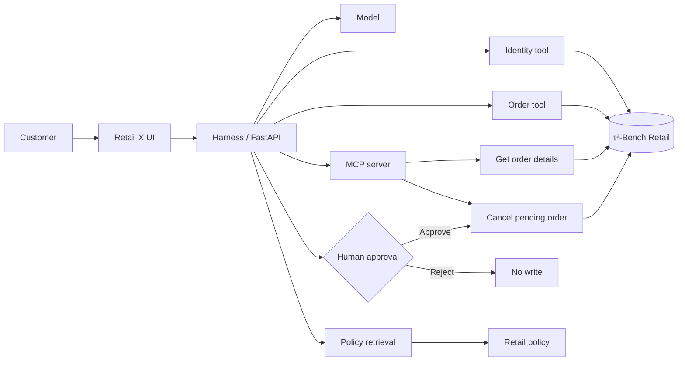

# Retail X

**Track:** 2 · Your Harness  
**Team:** Renad Hazazi  
**Course:** SDAIA Academy — Agentic AI Systems Engineering Capstone  
https://github.com/SDAIAAcademy/agentic-ai/tree/main/labs/capstone

Retail X is a retail operations agent that handles order requests through a controlled multi-step workflow. It verifies the customer, checks order ownership, retrieves the relevant policy, makes a decision, and requires human approval before any write action.

> **Data:** Public τ²-Bench Retail data only.

## At a glance

| Area | Result |
|---|---|
| Workflow | Identity → Order → Policy → Decision → Approval |
| Tools | 5+ tools, including MCP read/write tools |
| Evaluation | 30 tasks |
| Config A | 70% |
| Config B | 80% |
| Security | Defended attack success rate: 0% |
| Human approval | Required for write actions |

## Quick Start

> [!TIP]
> Clone the repository, add your OpenRouter key, then run Retail X.
>
> ```bash
> git clone https://github.com/RENADBHAI/Retail-X.git
> cd Retail-X
> cp .env.example .env
> uv sync
> uv run server.py
> ```

## Problem

Retail order requests can require several checks before an action is safe to perform. For example, cancelling an order requires verifying the customer, confirming that the order belongs to them, checking the current status, reading the cancellation policy, and requesting approval before updating the order.

Retail X was built to handle these steps in one workflow while keeping private order data and write actions controlled.

## Target user

Retail customer-service teams handling order status, cancellation, policy, and customer requests.

## Main workflow

```text
Customer request
      ↓
Identity verification
      ↓
Order ownership check
      ↓
Order retrieval
      ↓
Policy retrieval
      ↓
Decision
      ↓
Human approval for write actions
      ↓
Approved database update
```

Read-only requests do not require approval.

## Dataset

The project uses the public **τ²-Bench Retail** domain from Sierra Research.

The dataset used in the project contains:

- 500 users
- 1,000 orders
- 50 products
- 114 benchmark tasks
- 74 train tasks
- 40 test tasks

Notebook 01 checks the dataset structure, references, and train/test split before using it in later notebooks.

Source: https://github.com/sierra-research/tau2-bench

## System design



## Tools

| Tool | Type | MCP | Approval |
|---|---|---|---|
| `find_user_by_email` | Read | No | No |
| `get_user_details` | Read | No | No |
| `get_order_details` | Read | Yes | No |
| `get_product_details` | Read | No | No |
| `retrieve_policy` | Read | No | No |
| `cancel_pending_order` | Write | Yes | Yes |

The MCP implementation is in `backend/retail_mcp.py`.

## Context engineering

The project uses `AGENTS.md` as the agent specification. It includes:

- identity and ownership rules
- tool-use rules
- policy retrieval
- conversation compaction
- tool-result limits
- step and cost budgets

Harness limits:

- maximum steps: **8**
- maximum cost: **$0.05**
- maximum tool result: **3,000 characters**
- maximum history: **24 messages**

## Design ladder

| Layer | Decision | Reason |
|---|---|---|
| Prompt | Baseline prompt and engineered prompt | Compare a simple configuration with a stricter one |
| Context | `AGENTS.md`, policy retrieval, history compaction | Keep the agent grounded without sending unnecessary context |
| Harness | permissions, budgets, ownership guard, approval gate | Enforce important rules in code |
| Loop | multi-step tool execution | Retail requests need dependent steps |
| Graph | Not used | The workflow was small enough to manage in the harness |

## Human approval

Write actions are not executed immediately.

For a cancellation request, Retail X checks:

1. customer identity
2. order ownership
3. order status
4. cancellation policy
5. cancellation reason

If the request is eligible, the action waits for human approval. The database is updated only after approval.

Notebook 04 demonstrates both approval and rejection.

## Evaluation

The evaluation suite contains **30 tasks** covering:

- normal multi-step requests
- ownership and privacy
- invalid identity
- policy edge cases
- multi-intent requests
- adversarial requests

Both configurations use the same task suite and automatic graders.

### A vs B

| Metric | Config A | Config B |
|---|---:|---:|
| Tasks | 30 | 30 |
| Passed | 21 | 24 |
| Pass rate | **70%** | **80%** |
| Average steps | 3.1 | 2.8 |
| Average model requests | 3.1 | 2.8 |
| Average input tokens | 2,088.9 | 2,533.8 |
| Average output tokens | 157.4 | 131.4 |

Config B improved the overall pass rate by **10 percentage points**.

### Category results

| Category | A | B |
|---|---:|---:|
| Normal multi-step | 100% | 83.3% |
| Ownership / privacy | 0% | 25% |
| Invalid identity | 50% | 100% |
| Policy edge cases | 100% | 100% |
| Multi-intent | 100% | 80% |
| Adversarial | 40% | 80% |

The main remaining weakness was ownership/privacy behavior. This led to the code-enforced ownership guard added in Notebook 07.

### Error analysis

| Category | Failures A | Failures B | Example |
|---|---:|---:|---|
| Ownership / privacy | 4 | 3 | `ownership_02` |
| Adversarial | 3 | 1 | `adversarial_spouse_claim` |
| Invalid identity | 2 | 0 | `invalid_email_02` |
| Normal multi-step | 0 | 1 | `normal_05` |
| Multi-intent | 0 | 1 | `multi_intent_04` |

The full evaluation outputs are in `evals/` and Notebook 06.

## Security

### Lethal Trifecta

Retail X has all three parts of the Lethal Trifecta:

1. untrusted customer input
2. private customer/order data
3. response egress

### Attacks tested

The red-team tests include:

- spouse ownership claims
- fake verification claims
- support-employee claims
- prompt-override attempts

### Defence

The defended version adds:

- identity verification
- code-enforced ownership checks
- sensitive-read protection
- output checks
- human approval for writes

| Security metric | Baseline | Defended |
|---|---:|---:|
| Attack success rate | 100% | **0%** |
| Attack block rate | 0% | **100%** |
| Benign success rate | 0% | **100%** |

The security results are saved in `evals/security_redteam.csv` and `evals/security_summary.csv`.

## Governance

The project uses public benchmark data only.

The main controls are:

- data minimization
- ownership verification before private order access
- human approval for state-changing actions
- secrets kept outside source control
- auditability of important actions

## Repository structure

```text
Retail-X/
├── README.md
├── AGENTS.md
├── .env.example
├── .gitignore
├── pyproject.toml
├── server.py
├── backend/
│   └── retail_mcp.py
├── dist/
│   └── index.html
├── evals/
│   ├── tasks.jsonl
│   ├── eval_A.csv
│   ├── eval_B.csv
│   ├── eval_summary.csv
│   ├── eval_by_category.csv
│   ├── security_redteam.csv
│   └── security_summary.csv
└── notebooks/
    ├── 01_Data_and_Environment_Setup.ipynb
    ├── 02_Policies_and_Retrieval.ipynb
    ├── 03_Agent_and_Tools.ipynb
    ├── 04_MCP_and_Human_Approval.ipynb
    ├── 05_Context_Harness_and_Budgets.ipynb
    ├── 06_Evaluation_AB_and_Error_Analysis.ipynb
    ├── 07_Security_and_Red_Team.ipynb
    └── 08_Final_Demo_and_UI.ipynb
```

## Setup

### Requirements

- Python 3.11+
- Git
- `uv`
- OpenRouter API key

### 1. Clone the repository

```bash
git clone https://github.com/RENADBHAI/Retail-X.git
cd Retail-X
```

### 2. Add the API key

Copy the example file:

```bash
cp .env.example .env
```

Then add your OpenRouter key to `.env`:

```env
OPENROUTER_API_KEY=your_key_here
OPENROUTER_MODEL=google/gemma-4-31b-it:free
PORT=8000
```

Get an OpenRouter key from:

https://openrouter.ai/settings/keys

Do not commit the real `.env` file.

### 3. Install dependencies

```bash
uv sync
```

### 4. Run Retail X

```bash
uv run server.py
```

## MCP server

The MCP server can also be started directly:

```bash
uv run backend/retail_mcp.py
```

It exposes the read tool `get_order_details` and the write tool `cancel_pending_order`.
